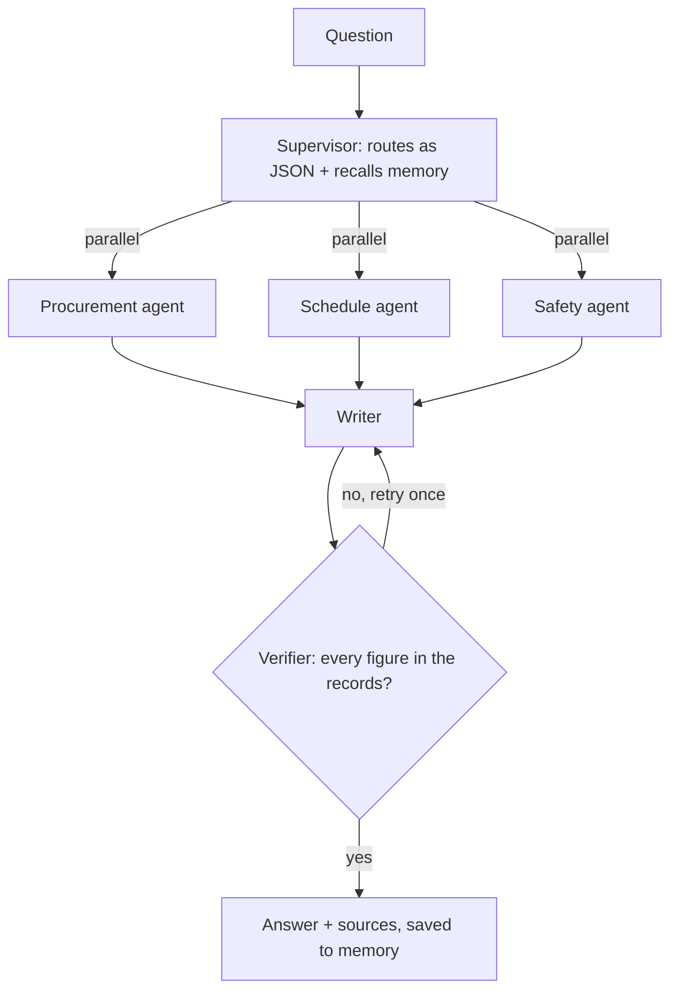

# BuildTrack

Construction project management and site-operations platform. Projects, tasks, workforce, inventory, procurement, reports, and an operations-intelligence layer: Site Assistant, risk rules, material forecasting, budget checks, monitoring, progress evidence, and an Innovation & Safety hub.

| Folder | Stack |
|---|---|
| [`backend/`](backend) | FastAPI · Python 3.11+ · MongoDB (Motor) |
| [`frontend/`](frontend) | React 18 · Vite · Tailwind CSS · JavaScript |

## Quick start

### 1. Backend

```bash
cd backend
python -m venv .venv
.venv\Scripts\activate            # macOS/Linux: source .venv/bin/activate
pip install -r requirements-dev.txt
copy .env.example .env            # macOS/Linux: cp .env.example .env
```

**Configure `.env`**
- Set `MONGODB_URL` to your MongoDB connection string. MongoDB Atlas free tier is fine.
- Set `MONGODB_DB_NAME`.
- Set `JWT_SECRET_KEY` to a long random value, for example:
  ```bash
  python -c "import secrets; print(secrets.token_urlsafe(48))"
  ```

**Create the indexes and the first administrator account.** It asks for the password at the prompt:

```bash
python scripts/setup_database.py --admin-email you@example.com
```

**Run the backend**

```bash
python -m uvicorn app.main:app --host 127.0.0.1 --port 8001
```

API docs: http://127.0.0.1:8001/docs

### 2. Frontend

```bash
cd frontend
npm install
copy .env.example .env            # VITE_API_BASE_URL=http://127.0.0.1:8001/api/v1
npm run dev
```

Open http://127.0.0.1:5173 and sign in with the administrator account.

## Roles and permissions

There are seven roles: admin, project manager, site engineer, worker, vendor, client and contractor.

**Access control**
- Access is permission-based and enforced by the backend (`backend/app/core/permissions.py`).
- Users see only the projects they are assigned to. Assign them in **Settings → Access**.
- Extra duties, such as recording payments or receiving deliveries, are granted per user, not through extra roles.

## Site Assistant (AI)

The assistant has three answer modes, set with `AI_PROVIDER` in `backend/.env`:

| `AI_PROVIDER` | Cost | Notes |
|---|---|---|
| `quick` (default) | Free | No AI model. Answers common questions straight from your records |
| `ollama` | Free | A local model through [Ollama](https://ollama.com) rephrases those answers. Install Ollama and run `ollama pull gemma2:2b` |
| `anthropic` | Paid | Claude. Needs `ANTHROPIC_API_KEY` and `AI_ENABLED=true` |

The Overview, risks, forecasts, budget checks and reports do not use AI and are always free.

### Agent mode (multi-agent, local, free)

**Site Assistant → Agent mode** runs a LangGraph multi-agent workflow on an open-source model (Gemma by default) served by Ollama on your computer. It never calls a paid API. Code: [`backend/app/modules/agent`](backend/app/modules/agent).



What each part does:

- **Routing.** The supervisor asks the model which specialists to use, as JSON. If the reply is unusable, it falls back to keyword routing.
- **Tool use (ReAct).** Each specialist loops: the model picks a tool as JSON, and the call is checked against the tool's schema and the user's permissions before it runs. Invalid calls go back to the model with the error, so it can correct itself.
- **Grounding.** If a small model answers without calling any tool, the agent runs its default tool so the answer still comes from records.
- **RAG and memory.** A Chroma vector store holds safety reports, suggestions, saved reports and project descriptions, plus each user's past verified answers as long-term memory. Searches are filtered by permission, project and owner. Anonymous safety reporters are never indexed.
- **Reflection.** A deterministic verifier checks every number in the draft against the evidence. Unsupported figures go back to the writer once; if they remain, they are flagged.
- **Safety.** Tools are read-only. The one write tool only proposes an action, which a person must approve in the Action Center.
- **API.** `POST /api/v1/ai/agent/chat` streams each step as newline-delimited JSON, and the UI shows it as a live timeline.

Setup:

```bash
ollama pull gemma2:2b            # the agents' model (AGENT_MODEL, defaults to OLLAMA_MODEL)
ollama pull nomic-embed-text     # optional: meaning-based search; without it, local keyword vectors are used
```

Then open **Agent mode** and press **Rebuild search index** (it also builds automatically on first use). A larger model such as `gemma3:4b` makes better tool choices: set `AGENT_MODEL` and pull it.

## Tests

```bash
cd backend && python -m pytest          # in-memory MongoDB, no network
cd frontend && npm test && npm run lint
```

## Configuration reference

All backend settings, with safe defaults, are listed in [`backend/.env.example`](backend/.env.example):
- AI
- Monitoring schedule
- Private uploads
- Optional email and voice calls

Never commit `.env` files.
